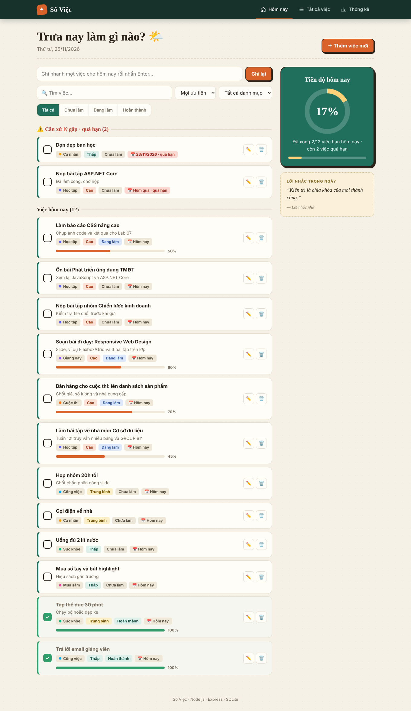
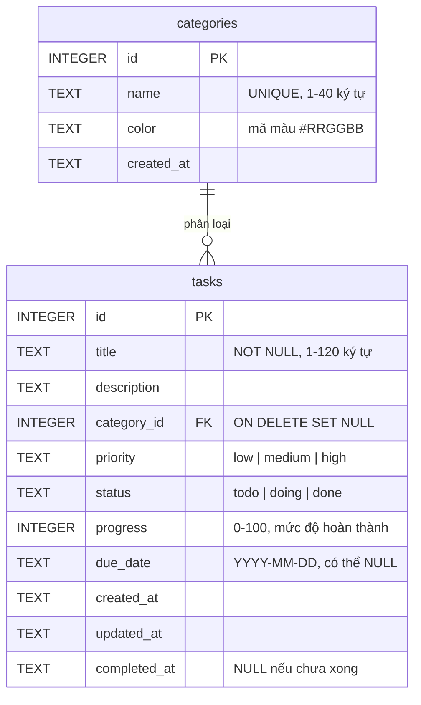
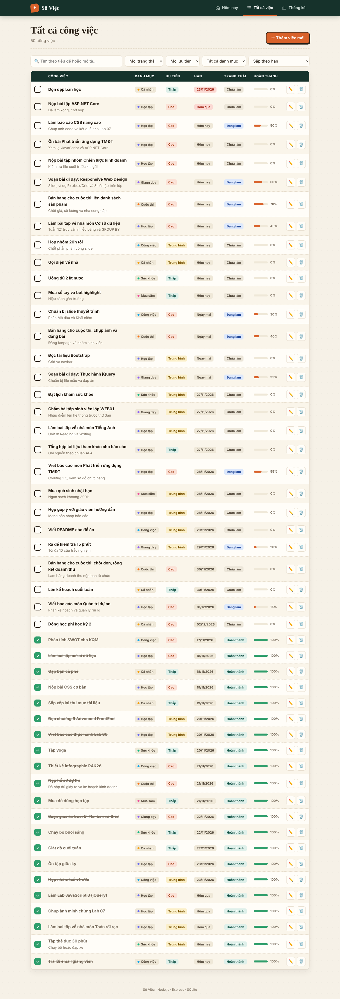
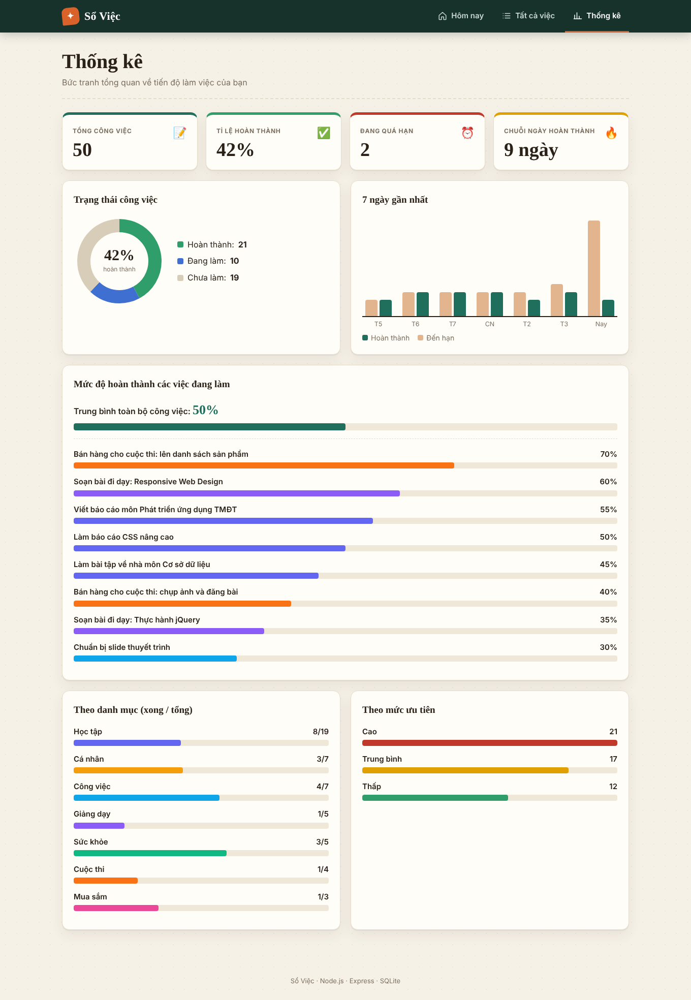

# Sổ Việc – Ứng dụng quản lý công việc cá nhân

Ứng dụng web quản lý task cá nhân, viết bằng **Node.js + Express**, lưu dữ liệu trong **SQLite** (thư viện `better-sqlite3`). Giao diện thuần HTML/CSS/JavaScript, không cần build và không phụ thuộc CDN: thanh điều hướng xanh thông phía trên, nền giấy kem, điểm nhấn cam đất, tiêu đề dùng font serif. Có sẵn **dữ liệu mock** để chạy là thấy ngay.



## Chức năng

| Nhóm | Mô tả |
|---|---|
| **Hôm nay** | Hiển thị các task có hạn hôm nay và các task quá hạn chưa xong; vòng tiến độ trong ngày và lời nhắc mỗi ngày ở cột bên phải; thêm nhanh bằng Enter; **tìm kiếm** theo tiêu đề/mô tả; **lọc** theo trạng thái, mức ưu tiên, danh mục; tick để hoàn thành. |
| **Tất cả công việc** | Bảng toàn bộ task; tìm kiếm, lọc (trạng thái, ưu tiên, danh mục), sắp xếp (theo hạn, ưu tiên, mới nhất); **thêm – sửa – xóa** bằng hộp thoại có kiểm tra dữ liệu. |
| **Thống kê** | Tổng số việc, tỉ lệ hoàn thành, số việc quá hạn, chuỗi ngày hoàn thành liên tiếp; biểu đồ tròn theo trạng thái; biểu đồ cột 7 ngày gần nhất (hoàn thành / đến hạn); thống kê theo danh mục và mức ưu tiên. |
| **Mức độ hoàn thành** | Mỗi việc có thanh tiến độ 0–100% (thanh trượt trong hộp thoại thêm/sửa). Quy tắc tự đồng bộ: 100% = Hoàn thành, 1–99% = Đang làm, chọn "Chưa làm" = 0%. Trang Thống kê có mức trung bình và danh sách các việc đang làm. |
| **Dữ liệu mock** | 50 task, 7 danh mục (có thêm *Giảng dạy*, *Cuộc thi*: soạn bài đi dạy, bán hàng cho cuộc thi, bài tập về nhà, báo cáo môn học…), ngày được sinh tương đối so với hôm nay nên trang "Hôm nay" luôn có việc. Chỉ nạp khi CSDL còn trống. |

Giao diện responsive: máy tính dùng thanh điều hướng trên cùng; điện thoại chuyển thành thanh tab cố định ở đáy màn hình. Xem thêm ảnh trong thư mục [`docs/`](docs).

## Cách chạy

Yêu cầu: **Node.js 18 trở lên**. CSDL dùng `better-sqlite3`; nếu máy không cài được thư viện này (thiếu bộ biên dịch C++), ứng dụng tự chuyển sang `node:sqlite` có sẵn trong Node 22.13 trở lên.

```bash
npm install
npm start
# mở http://localhost:3000
```

Các lệnh khác:

```bash
npm test          # chạy 8 bài kiểm thử API + CSDL
npm run reset     # xóa CSDL, lần chạy sau sẽ nạp lại dữ liệu mock
PORT=8080 npm start   # đổi cổng (Windows PowerShell: $env:PORT=8080; npm start)
```

CSDL nằm ở `data/todo.db` (tự tạo khi chạy lần đầu, đã đưa vào `.gitignore`).

## Kiến trúc CSDL

Chọn **SQLite** vì ứng dụng cá nhân, chỉ cần một file, không phải cài server, vẫn hỗ trợ đủ khóa ngoại, ràng buộc CHECK, chỉ mục, trigger và truy vấn tổng hợp cho thống kê.



Toàn bộ lược đồ ở [`db/schema.sql`](db/schema.sql). Điểm chính:

- **Ràng buộc toàn vẹn:** `CHECK` cho độ dài tiêu đề, `priority`, `status`, định dạng ngày và màu; `UNIQUE` cho tên danh mục; khóa ngoại bật bằng `PRAGMA foreign_keys = ON`.
- **Xóa danh mục không mất việc:** `ON DELETE SET NULL`, task chuyển về "Chưa phân loại".
- **Mức độ hoàn thành:** cột `progress` có `CHECK (progress BETWEEN 0 AND 100)`; API giữ đồng bộ với `status`. CSDL cũ chưa có cột này sẽ được tự nâng cấp khi khởi động (việc đã xong thành 100%).
- **Chỉ mục:** `due_date`, `status`, `category_id`, `completed_at` để lọc, tìm việc hôm nay và thống kê theo ngày nhanh.
- **Trigger `trg_tasks_touch`:** tự cập nhật `updated_at`; khi đổi trạng thái sang `done` thì ghi `completed_at`, khi mở lại thì xóa. Nhờ vậy thống kê "hoàn thành mỗi ngày" và "chuỗi ngày" luôn đúng dù cập nhật từ đâu.
- **An toàn truy vấn:** mọi câu SQL dùng tham số (prepared statement), từ khóa tìm kiếm được escape `%`, `_`.
- **Thống kê:** dùng `GROUP BY` và `COUNT` ngay trong SQL (theo trạng thái, ưu tiên, danh mục, ngày).

## Cấu trúc thư mục

```
todo-app/  (tên thư mục tùy ý)
├── server.js            Khởi động server
├── src/
│   ├── db.js            Mở CSDL, chạy schema, nạp dữ liệu mock nếu rỗng
│   └── app.js           Express app: REST API + kiểm tra dữ liệu + thống kê
├── db/
│   ├── schema.sql       Lược đồ CSDL
│   └── seed.js          Dữ liệu mock
├── public/              Giao diện web
│   ├── index.html       Hôm nay
│   ├── tasks.html       Tất cả công việc (thêm / sửa / xóa)
│   ├── stats.html       Thống kê
│   ├── css/style.css
│   └── js/              common.js, today.js, tasks.js, stats.js
├── tests/api.test.js    Kiểm thử bằng node:test
└── docs/                Ảnh giao diện / mockup
```

## API

| Method | Đường dẫn | Mô tả |
|---|---|---|
| GET | `/api/tasks?scope=today\|all&status=&priority=&category=&q=&sort=due\|priority\|progress\|newest&today=YYYY-MM-DD` | Danh sách, có tìm kiếm / lọc / sắp xếp |
| GET | `/api/tasks/:id` | Chi tiết một việc |
| POST | `/api/tasks` | Thêm việc (`title` bắt buộc, `progress` 0–100 tùy chọn) |
| PUT | `/api/tasks/:id` | Sửa việc |
| PATCH | `/api/tasks/:id/toggle` | Đổi hoàn thành / chưa hoàn thành |
| DELETE | `/api/tasks/:id` | Xóa việc |
| GET / POST | `/api/categories` | Danh sách (kèm số việc) / thêm danh mục |
| DELETE | `/api/categories/:id` | Xóa danh mục |
| GET | `/api/stats?today=YYYY-MM-DD` | Số liệu thống kê |

Lỗi trả về JSON `{ "error": "..." }` với mã 400 / 404 / 409.

## Mockup giao diện

| Hôm nay | Tất cả công việc | Thống kê |
|---|---|---|
|  |  |  |

Hộp thoại thêm / sửa: [`docs/4-them-sua-cong-viec.png`](docs/4-them-sua-cong-viec.png). Bản điện thoại: `docs/mobile-*.png`.

## Đưa lên GitHub

```bash
git init
git add .
git commit -m "So Viec: Node.js + SQLite"
git branch -M main
git remote add origin <link-repo-cua-ban>
git push -u origin main
```

> `node_modules/` và `data/` đã nằm trong `.gitignore`. Người khác chỉ cần `npm install && npm start`.
